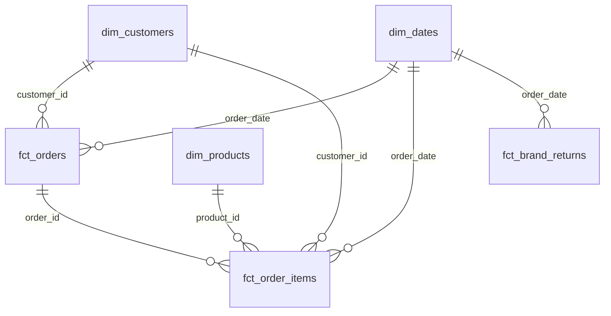
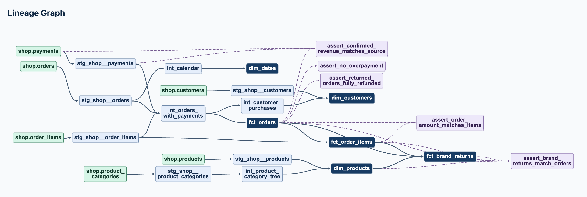

# Витрины интернет-магазина в Greenplum

как я поняла, здесь нужно было из сырых данных собрать в гринплам витрины для анализа продаж, покупателей и возвратов. и получается у нас исходные таблицы лежат в postgres, лоадер копирует их в гринплам, а сам стенд запускается через докер. в dbt я разделила обработку на staging, intermediate и marts, как мы делали на лекциях, то есть получили три этапа - подготовку отдельных таблиц, соединения и расчёты, и потом уже готовые витрины. 

в работе с платежами оказалось что важно сначала получить итог по каждому заказу, иначе из-за нескольких платежей сумма заказа начнёт повторяться при соединении. ещё дополнительно решила добавить витрину возвратов по брендам, где заказ учитывается для бренда один раз, даже если в нём несколько товаров этого бренда. ну для удобства в общем, как будто это именно на практике было бы нужно. ну и dbt у меня собирает модели по зависимостям и запускает тесты на ключики, связи и суммы

## Модель данных

| Витрина | Зернистость | Для чего нужна |
| --- | --- | --- |
| `fct_orders` | Один нетестовый заказ | Средний чек по городам, суммы оплат и возвратов. |
| `fct_order_items` | Один товар в нетестовом заказе | Выручка по категориям и месяцам. |
| `dim_customers` | Один зарегистрированный клиент | Доля покупателей среди клиентов каждого канала привлечения. |
| `dim_products` | Один товар | Группировка по бренду, категории, её родителю или корню дерева. |
| `dim_dates` | Один календарный день | Сравнение продаж по месяцам, кварталам и дням недели. |
| `fct_brand_returns` | Один бренд за один день оформления заказов | Доля возвратов среди заказов с товарами бренда. |

### Хранение в Greenplum

| Витрина | Распределение | Хранение | Почему |
| --- | --- | --- | --- |
| `fct_orders` | `DISTRIBUTED BY (order_id)` | Строковое `heap` | Номер заказа используется в соединениях с позициями и совпадает с ключом распределения `raw.orders`, `raw.order_items` и `raw.payments`. |
| `fct_order_items` | `DISTRIBUTED BY (order_id)` | Колоночное `ao_column` | Одинаковый ключ у двух фактов позволяет соединять их по `order_id` на одном сегменте. При разных ключах нужна пересылка строк, а колоночное хранение позволяет читать только нужные поля. |
| `dim_customers` | `DISTRIBUTED REPLICATED` | Строковое `heap` | Учебное измерение содержит 40 клиентов. Его копия на каждом сегменте позволяет соединять факт по `customer_id` без пересылки справочника. |
| `dim_products` | `DISTRIBUTED REPLICATED` | Строковое `heap` | Справочник из 13 товаров можно целиком хранить на каждом сегменте и локально присоединять к позициям по `product_id`. |
| `dim_dates` | `DISTRIBUTED REPLICATED` | Строковое `heap` | Каждый сегмент может присоединить небольшой календарь по `order_date`. |
| `fct_brand_returns` | `DISTRIBUTED BY (brand_date_id)` | Строковое `heap` | Ключ из даты и бренда распределяет строки по сегментам даже при небольшом числе брендов. |

### Граф зависимостей dbt

